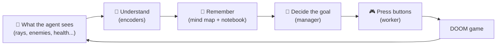
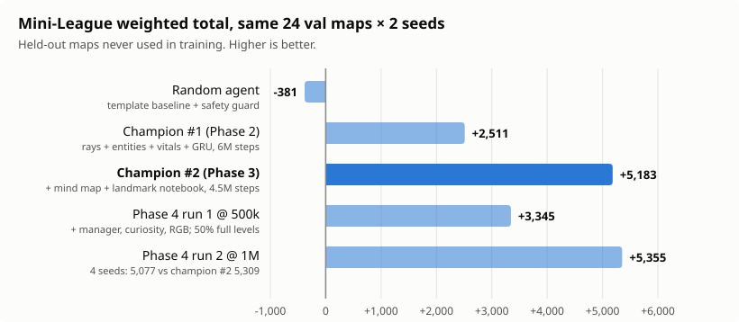
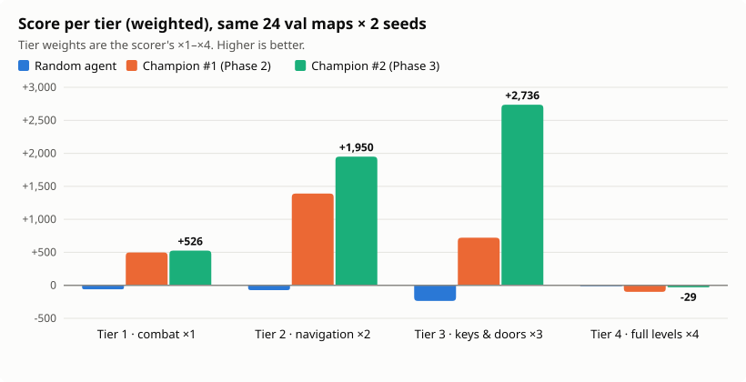
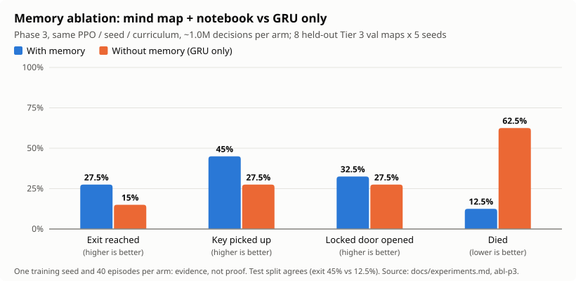
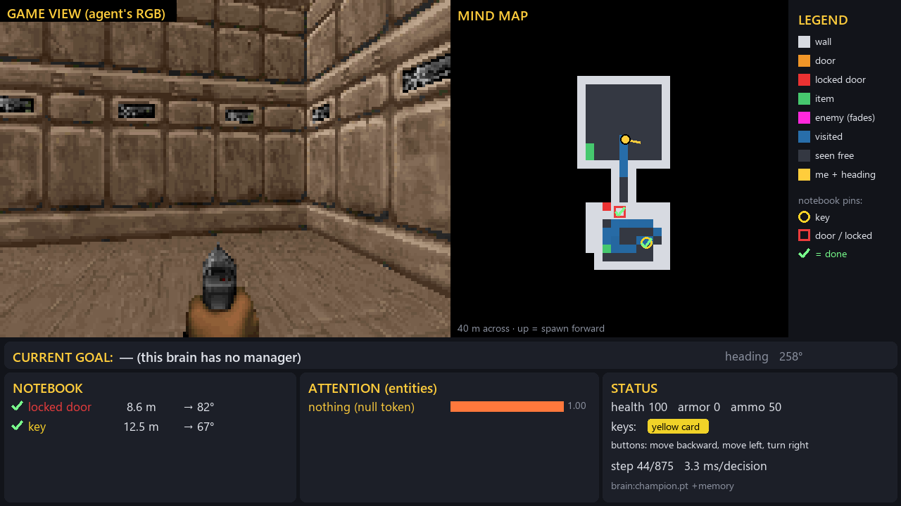
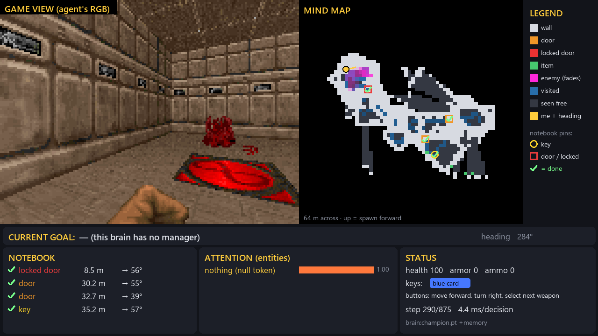

# AK-Doom

**A DOOM-playing AI with its own memory: mind map, landmark notebook and curiosity-driven RL on ViZDoom.**

> **Agent name:** *Smriti* (स्मृति), which means "memory".
> **Track:** Yugaantar 2026 · DevForge — Track 1, *"Can It Play DOOM?"*
> **Built on:** the official [`devforge-doom-template`](https://github.com/Reinforce-SST/devforge-doom-template).
> **Status:** 🎮 Playing. The submitted agent is **champion #2**, the Phase 3 memory brain (mind map + landmark notebook): **+5,182.69** on our 24 validation maps vs +2,511.03 for champion #1. It solves all key-near-start puzzles and opens locked doors; big Freedoom levels are still its weak spot. A Phase 4 brain (manager + curiosity + RGB, trained on GPU) matches it but did not beat it on 4 seeds, so champion #2 stays.

## What is this?

Smriti is an AI player for DOOM. It learns only by playing the game, with no recorded data and no hand-written moves. Then it plays **maps it has never seen**: it fights monsters, explores rooms, finds keycards, remembers where the locked doors are and reaches the exit.

## The idea in one picture



## What makes us different (our USP)

1. **It draws its own map in its head.** The agent builds a "mind map" of the places it has been, even though the game never gives it a map.
2. **It keeps a notebook of important things.** When it sees a locked door or a keycard, it writes down where that thing is and goes back for it later.
3. **It thinks in two levels.** A *manager* picks the goal ("explore", "fight", "go get the key"), and a *worker* handles the movement and shooting.
4. **It is curious.** It gets an extra reward for visiting new places, so it doesn't get stuck in corners.
5. **You can watch it think.** A live *Mind View* dashboard shows its map, its notebook and its current goal while it plays.

## Results

Same 24 held-out validation maps × 2 seeds for every brain (never trained on; scored by our copy of the official scorer, `scripts/evaluate.py`):





Memory is what moved Tier 3: with the mind map and notebook the agent finds keys and opens locked doors far more often, and dies far less ([ablation](docs/experiments.md), one training seed: evidence, not proof):



### Watch it think (Mind View)

| Key near the start: key → locked door → exit | Far key: remembered across rooms |
|---|---|
|  |  |

Videos (champion #2 on validation maps, including two honest failures): [docs/demo](docs/08-DEMO-AND-BRIEF.md#81-mind-view-dashboard). Record your own with `scripts/mind_view.py`. Project brief (2 pages): [docs/brief/brief.pdf](docs/brief/brief.pdf).

## Quick start

Python 3.13 and [uv](https://docs.astral.sh/uv/):

```bash
uv sync                      # installs vizdoom, gymnasium and the official wrapper (env/)
uv run python validate.py    # official pre-submission check
uv run pytest                # tests
```

On Windows, set `PYTHONUTF8=1` first (see [Repo & Workflow §6.1](docs/06-REPO-AND-WORKFLOW.md#61-setting-up-step-by-step)).

Phase 0 tools:

```bash
uv run python scripts/inspect_observation.py   # print one real observation, readable
uv run python scripts/measure_odometry.py --out configs/odometry.json   # calibrate turning/movement
```

Closest check to the real scorer (needs Docker):

```bash
docker build -t devforge-doom .
python validate.py --docker --image devforge-doom
```

Evaluate, train, show:

```bash
uv run python scripts/build_map_catalog.py    # map library -> maps/catalog.json + maps/lists/*.txt
uv run python scripts/evaluate.py --seeds 2 --jobs 8      # Mini-League on validation maps (our copy of the scorer)
uv run python scripts/benchmark_latency.py    # speed check against the official limits
uv run python -m training.train --stage 3 --memory on --name my-run --steps 2000000   # train (add --device cuda on a GPU)
uv run python scripts/export_champion.py runs/my-run/latest.pt --eval runs/eval/my-run-val.json   # promote only if it beats the champion
uv run python scripts/mind_view.py --map maps/curated/val/t3-keynear-100000.wad:MAP01 --ticks 3500 --out runs/demo/keynear.mp4
uv run python scripts/make_charts.py          # redraw the results charts in docs/figures/
uv run pytest tests/agent                     # our contract + unit tests
```

Training on a Windows NVIDIA GPU: see [Repo & Workflow §6.1](docs/06-REPO-AND-WORKFLOW.md#61-setting-up-step-by-step).

## Repository layout

```
env/                  official ViZDoom wrapper (doom_env): don't edit (the scorer ignores it)
maps/                 template test map + our training map tools
submission/agent.py   DoomAgent: the evaluation entry point
submission/smriti/    the agent's brain (encoders, memory, policy)
submission/weights/   champion weights (Git LFS)
training/             training pipeline (PPO, rewards, curiosity, curriculum)
scripts/              train / evaluate / benchmark entry points
validate.py           official validator: run before every merge
tests/                template tests + our tests
docs/                 official docs + our planning docs, brief/, figures/ (charts), demo/ (Mind View videos)
```

## Documentation

**Official (from the template; read these first):**

| Doc | What's inside |
| --- | --- |
| [CONTRACT.md](docs/CONTRACT.md) | Observation/action spaces and the `DoomAgent` interface |
| [RULES.md](docs/RULES.md) | What's allowed and what gets you disqualified |
| [SUBMISSION.md](docs/SUBMISSION.md) | Submission checklist, Git LFS, 1 GB limit, `requirements.txt` |
| [EVALUATION.md](docs/EVALUATION.md) | Map tiers, scoring, hardware, timeouts |

**Ours (read in order; each answers one question):**

| # | Document | Question it answers |
|---|----------|---------------------|
| 1 | [PRD](docs/01-PRD.md) | What are we building, and how do we know it's good? |
| 2 | [System Architecture](docs/02-SYSTEM-ARCHITECTURE.md) | What are the big parts, and how do they connect? |
| 3 | [System Design](docs/03-SYSTEM-DESIGN.md) | How does each part work inside? |
| 4 | [Training Plan](docs/04-TRAINING-PLAN.md) | How does the agent learn? |
| 5 | [Testing Plan](docs/05-TESTING-PLAN.md) | How do we prove it works? |
| 6 | [Repo & Workflow](docs/06-REPO-AND-WORKFLOW.md) | Where does the code go, and how do we work together? |
| 7 | [Roadmap](docs/07-ROADMAP.md) | In what order do we build it? |
| 8 | [Demo & Brief](docs/08-DEMO-AND-BRIEF.md) | How do we show it off and write the 2-page PDF? |
| 9 | [Decisions & Risks](docs/09-DECISIONS-AND-RISKS.md) | Why did we choose this, and what could go wrong? |
| 10 | [Compliance Checklist](docs/10-COMPLIANCE-CHECKLIST.md) | Are we following every rule? |
| — | [Glossary](docs/GLOSSARY.md) | What do these words mean? |
| — | [Experiment Log](docs/experiments.md) | What did each training run teach us? |

## Rules in one minute

- Actions must come from **trained neural parameters**: no rule trees, no `A*`/Dijkstra/BFS, no `atan2` aimbots, no unmodified off-the-shelf SB3.
- Change anything you want **during training**. Evaluation uses the **vanilla engine**, the official wrapper and **unseen maps**.
- The core architecture and training pipeline are built during the hackathon. Libraries are fine.

## Next steps

See [Roadmap Phase 6](docs/07-ROADMAP.md#phase-6--polish--present): team names in the brief, repo URL to the organisers, one guarded final test-map evaluation of the submitted brain, final merge before the deadline.
