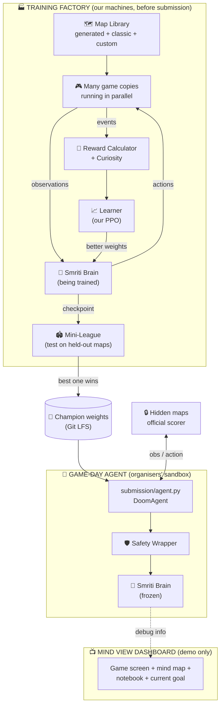
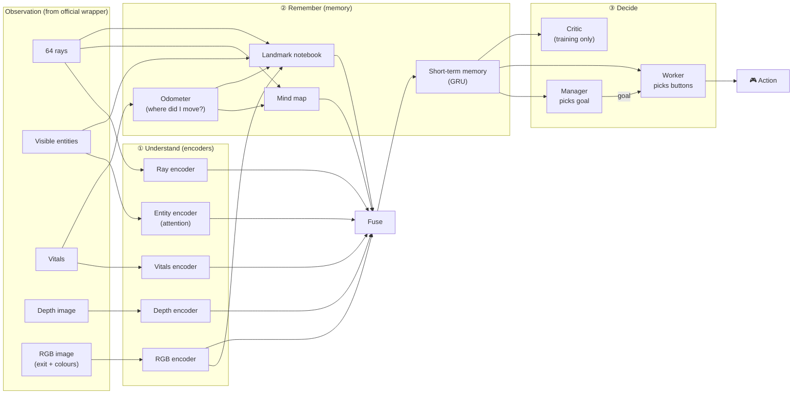

# 2. System Architecture

> **One line:** There are two halves. A **Training Factory** runs on our machines and produces a brain file. The **Game-Day Agent** loads that brain file and plays the hidden maps.

---

## 2.1 The big picture

## 2.2 The parts

| # | Part | What it does (plain words) | Runs where |
|---|------|----------------------------|-----------|
| 1 | **Map Library** | Collects and generates many DOOM maps, split into *train*, *validation* and *test* | Factory |
| 2 | **Game Runner** | Runs many DOOM games at once using the official `doom_env` wrapper | Factory |
| 3 | **Smriti Brain** | The neural network: understand → remember → decide | Both |
| 4 | **Reward Calculator** | Turns game events (key found, damage taken...) into a learning signal | Factory |
| 5 | **Curiosity Module** | Gives bonus reward for visiting new places | Factory |
| 6 | **Learner (PPO)** | Updates the brain so good actions become more likely | Factory |
| 7 | **Curriculum Manager** | Starts with easy maps and moves to harder ones as the agent improves | Factory |
| 8 | **Mini-League** | Tests every checkpoint on held-out maps and keeps the best one (the "champion") | Factory |
| 9 | **DoomAgent** | The official entry point that the organisers call | Game-Day |
| 10 | **Safety Wrapper** | Catches any error and still returns a valid action | Game-Day |
| 11 | **Mind View Dashboard** | Shows what the agent is thinking, live | Demo |

## 2.3 Inside the brain

The **same brain** is used in training and on game day. Only the learning switch is off on game day.

Full details are in [System Design](03-SYSTEM-DESIGN.md).

## 2.4 Life of one decision (game day)

Every 4 game ticks, this happens in about **20 ms**:

1. 📥 The organisers' runner calls `agent.act(observation)`.
2. 🛡️ The safety wrapper starts a timer and a `try` block.
3. 🧭 **Odometer**: estimate how far we moved (from velocity) and turned (from our last turn button) since the last step.
4. 🗺️ **Mind map**: update our position on the map, then draw what the rays see.
5. 📒 **Notebook**: if a key, locked door or exit is visible, save or update its position.
6. 🧠 **Encoders**: turn rays, entities, vitals, depth and RGB into numbers.
7. 🔗 **Fuse + GRU**: combine everything with short-term memory.
8. 🎯 **Manager**: every 8 decisions, choose a goal (explore / fight / get key / go to door / go to exit).
9. 🎮 **Worker**: choose the buttons for this moment, given the goal.
10. 📤 Return a 9-button array of 0/1. If anything failed, return a **safe default action** instead.

## 2.5 Life of one training round (factory)

1. Curriculum Manager picks maps for the current stage.
2. N game copies play for a while and record *(what it saw, what it did, what it got)*.
3. Reward Calculator + Curiosity add up the rewards.
4. Learner (PPO) updates the brain.
5. Every K updates, a checkpoint goes to the **Mini-League**.
6. If it beats the current champion, it **becomes the champion**.
7. When the agent graduates a stage, the curriculum moves to harder maps.

## 2.6 Technology choices

| Need | Choice | Why |
|------|--------|-----|
| Game | `vizdoom==1.3.3` + official `doom_env` (`make_env`) | Required, and identical in training and evaluation |
| Environment setup | `uv sync` (Python 3.13), Docker for the final check | Comes with the template |
| Training rewards | `env.privileged_state()` (true position, kills, damage) | Official helper; training only |
| Neural networks | **PyTorch** | In the base image; team familiarity; easy to export |
| RL algorithm | **Our own PPO** (recurrent) | Stable, well understood, and judges want custom work |
| Parallel games | Python `multiprocessing` | Simple; the game runs fast on CPU |
| Experiment tracking | TensorBoard | Works offline, free |
| Maps | OBLIGE/ObAddon generator + Freedoom + custom WADs | Unlimited variety → better generalisation |
| Dashboard | Small local web app or OpenCV window | Simple to build, looks good in demos |
| Tests | `pytest` | Standard |

## 2.7 Boundaries and rules built into the architecture

- 🔒 **Game-Day Agent sees only the observation.** The game runs in a separate process; the agent never touches the engine. No network, read-only repo, scratch files only in `/tmp`.
- 🔒 **Training-only extras stay in the factory.** Cheats (infinite ammo, auto-doors), `privileged_state()` and the reward code live in `training/` and are never imported by `submission/`.
- 🔒 **One brain definition is shared.** The brain lives in `submission/smriti/` and training imports it from there, so what we test is what we ship.
- 🔒 **We don't edit `env/`.** The scorer ignores our copy and uses the official wrapper.
