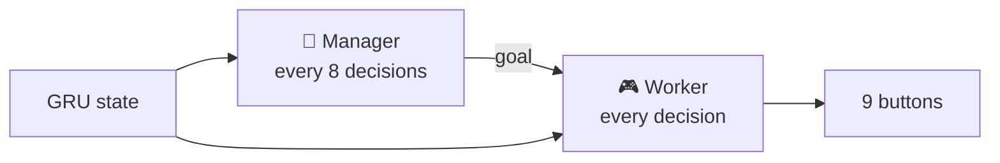

# 3. System Design

> **One line:** How each part of the brain works, in plain words, with starting numbers we will tune later.

> ⚠️ All sizes below are **starting values**. They change after experiments. The input and output formats come from the official [CONTRACT.md](CONTRACT.md) (version `1.0.0-draft`).

---

## 3.1 What the agent receives (inputs)

| Key | Shape | What it tells the agent | How we use it |
|-----|-------|-------------------------|---------------|
| `rays.distance` | 64 numbers (0–1) | Distance to the first thing that blocks movement in each direction (1.0 = nothing within 1,024 units) | Main sense for navigation |
| `rays.hit_type` | 64 labels | 0 none, 1 wall, 2 door, 3 locked door, 4 enemy, 5 item | Find doors, locked doors, enemies, items |
| `visible_entities.features` | 32 × 5 | For each visible thing: distance, sin/cos of angle, relative speed (forward/right) | Combat, dodging, item pickup |
| `visible_entities.entity_type` | 32 labels | melee/hitscan/projectile enemy, projectile, health, armor, ammo, weapon, key, barrel, other | Know *what* it is |
| `visible_entities.mask` | 32 × 0/1 | Which slots are real | Ignore padding |
| `vitals` | 17 numbers | Health, armor, weapon, ammo (×5), 6 key flags, velocity (forward/right/up, own frame) | Survival, "do I have a key?", odometer |
| `depth` | 120 × 160 | Distance picture of the view | Extra detail (stairs, ledges, doorways) |
| `rgb` | 120 × 160 × 3 | Colour picture (HUD hidden) | **Exit signs/switches** and key/door **colours** |

**Facts that shape the design:**
- Rays cover **360°** (index 0 = straight ahead, going counter-clockwise; 16 = left, 32 = behind). Entities only cover the **90° view**.
- Rays tell us *locked door* and entities tell us *key*, but **not the colour**. The **exit never appears** in rays or entities.
- Ray index 0 always points forward, so rays are already ego-centric.

---

## 3.2 Part ① — Understand (encoders)

Encoders turn each raw signal into a short list of numbers (an "embedding").

| Encoder | How it works (simple) | Output size |
|---------|------------------------|-------------|
| **Ray encoder** | The 64 rays form a ring. Per ray we feed distance + a small learned embedding of the hit type, then a **circular 1D convolution** slides around the ring and spots patterns like "corridor ahead" or "door on the left". | 128 |
| **Entity encoder** | Each of the 32 slots: 5 features + a learned type embedding → small MLP. **Attention** picks the important ones; masked slots are ignored. | 128 |
| **Vitals encoder** | Small MLP on scaled health, armor, ammo, key flags and velocity. | 32 |
| **Depth encoder** | Tiny CNN (3 layers) on a 60 × 80 downscaled depth image. | 64 |
| **RGB encoder** | Tiny CNN on a 60 × 80 downscaled image. Main job: notice the **exit** (signs, switch textures) and colours. Trained mostly through auxiliary tasks (§4.7) so it learns fast. | 64 |
| **Previous action** | The last 9 buttons we pressed, fed back in | 9 |

**Why attention for entities?** The brief asks how we *"handle variable numbers of enemies"*. Attention works with 0, 1 or 32 entities without changing the network, and it shows **which enemy the agent is focusing on**, which is great for the dashboard.

**Why feed back the previous action?** `USE` and `SELECT_NEXT_WEAPON` only fire when the button goes **down**, so the network must know whether it pressed them last step.

---

## 3.3 Part ② — Remember (memory system) ⭐ our USP

Memory has three layers. Think of a person in a dark building:

| Layer | Human analogy | What it stores | Lifetime |
|-------|---------------|----------------|----------|
| **Short-term memory (GRU)** | "What was I just doing?" | Recent moments, momentum | Seconds |
| **Mind map** | A sketch of the rooms you walked through | Walls, open space, doors, places visited | Whole map |
| **Landmark notebook** | Sticky notes: "locked door, back left!" | Keys, locked doors, doors, exit | Whole map |

All three are **wiped in `reset()`** before every new map.

### 3.3.1 Odometer: "how did I move?"

The game gives us **no position and no heading**, so we estimate our own movement. Implemented in `submission/smriti/memory/odometer.py`, with real-engine calibration generated by `scripts/measure_odometry.py`. The measured runtime coefficients live in `submission/smriti/memory/calibration.json`; `configs/odometry.json` records the fit and an independent validation episode.

- **Turning: predicted from our own buttons** (measured on `two_rooms.wad`; re-check on larger maps). A held turn rotates **7.03125°, then 12.3046875°, then 14.0625° every step after** (160 / 280 / 320 of Doom's 8192 fine angles). Releasing for one step resets it. Switching straight from left to right does *not* reset it, because Doom counts how long *any* turn button is held. Left is positive.
- **Moving: velocity plus friction.** `vel_forward`/`vel_right` are in the player's own frame (units per tic). Doom applies friction every tic, so simply multiplying by 4 is about 20% off. The best formula uses this step's **and** the previous step's velocity:
  `step distance = 2.86 × v_now + 1.56 × v_previous` (each turned into the spawn frame with our heading).
- **Fresh held-out validation (seed 733, 600 steps per map):** final position drift is **0.40%** on `two_rooms.wad`, **0.68%** on the Tier 2 maze, and **4.02%** on the Tier 3 key/door map. Maximum position error anywhere on those paths is 51.3, 60.3 and 248.2 map units respectively; maximum heading error rounds to 0° on all three. These are measured trajectories, not a general accuracy guarantee. See `configs/odometry-validation.json`. Wall contact accumulates error; later map consumers must account for that uncertainty.
- **Engine quirk (startup):** the first step after `reset()` is a no-op (0 turn, 0 move; the tic counter still advances). Held turn from the first action: 0°, 3.515625°, then 14.0625°. After exactly one no-op, the next left is 1.7578125°, then 12.3046875°, then 14.0625°. The production estimator uses measured startup transitions immediately; it does **not** insert startup actions or wait for warmup. Both turn buttons together cancel heading change but still advance the turn counter. Calibration uses a 5-step warmup only to measure the steady ramp separately.
- **Ray matching** (comparing ray rings to correct turning) is no longer needed; we keep it as an idea only if bigger maps show drift.
- We add these up to get our **position and heading relative to where we spawned**. This isn't a global coordinate; it's our own dead-reckoning guess.
- **Runtime API:** `Odometer.update(executed_action, resulting_observation)` returns immutable `Pose(x, y, heading_deg)`. Units are map units/degrees; origin is spawn, +x initially forward, +y initially left, heading is counter-clockwise in [-180°, 180°). Never pass the reset observation or the wrapper's stale terminal observation as a completed transition. Call `reset()` per episode.
- **Agent integration:** `DoomAgent.pose` exposes the estimate for future memory/dashboard consumers; check `odometry_valid` and `odometry_error`. The agent records the final SafetyGuard action and updates pose on the following observation. Invalid motion freezes pose and marks it invalid until reset, rather than treating missing data as zero movement. Action selection and checkpoint inputs are unchanged. No privileged state enters submission code.

Regenerate calibration from real engine measurements (this intentionally replaces the packaged calibration):

```bash
uv run python scripts/measure_odometry.py --steps 600 --seed 0 \
  --out configs/odometry.json --calibration-out submission/smriti/memory/calibration.json
```

Validate the shipped calibration without refitting, against training-only engine ground truth:

```bash
uv run python scripts/check_odometry.py --steps 600 --seed 733 \
  --map maps/two_rooms.wad --map maps/curated/val/t2-maze-100000.wad \
  --map maps/curated/val/t3-keydoor-100000.wad \
  --max-position-drift-fraction .05 --out configs/odometry-validation.json
```

This exits nonzero when the configured maximum position-drift fraction or heading-error budget is exceeded. Position budget is optional; heading defaults to 0.06°. A 5% maximum-drift budget here is an explicit regression tolerance, not a claim that dead reckoning is exact. Calibration rejects incompatible engine/contract metadata and nonfinite parameters; it has no fabricated fallback. Tests additionally cover rotated spawns, turn combinations, wall contact, resets, malformed inputs, fallback actions, and terminal-sample exclusion using live ViZDoom.

### 3.3.2 Mind map

- A **grid anchored at the spawn point**: **128 × 128 cells**, each cell **32 map units**, about 4,096 units across.
- **Layers per cell:** seen-free, wall, door, locked door, item, enemy-last-seen, visited (breadcrumbs), "how long ago".
- **Every step:** draw each ray into the grid (free space along the ray, the hit type at the end) and mark our own cell as visited.
- **Reading:** cut out a **32 × 32 window around the agent (≈ the 1,024-unit ray range), rotated so "up" = facing direction**, and pass it through a small CNN → 128 numbers.
- **Why rotate?** The network then always sees the map "from its own eyes", which generalises better.
- **Rule check:** this is *preprocessing and encoding observations*, which [RULES.md](RULES.md) allows. There is **no pathfinding or BFS** on the grid; the network decides where to go.
- **Built (Phase 3, `submission/smriti/memory/mindmap.py`):** 256 × 256 cells of 32 units (8,192 units, centred on spawn; points outside are not drawn). Free space is sampled every 16 units along each ray up to half a cell before the hit; seeing *through* a door/item cell clears it (door opened / item taken). Enemy marks and visit recency are stored as step stamps and fade (≈35 and ≈350 decisions). The 32 × 32 crop takes the **max over 2 × 2 sub-samples per pixel**, so rotation never drops a one-cell door or corner. Output is `uint8` (8 × 32 × 32) → `MapEncoder` (3 stride-2 convs → 128). Pure NumPy, < 1 ms per step (map + notebook together).

### 3.3.3 Landmark notebook

- **16 slots.** Each slot holds: *type* (key, locked door, door, exit), *position in our spawn frame*, *time last seen*, *done?* (picked up / opened), and *colour if known*.
- **Writing:** a landmark is spotted when a ray hits a door/locked door, an entity of type `key` is visible, or the RGB head thinks it sees an exit. We update a matching nearby slot or fill an empty one.
- **Key detection:** when a key flag in `vitals` flips from 0 to 1, the nearest "key" slot is marked done, and we now know the **colour** of the key we hold.
- **Colour (optional):** sample the RGB pixels in the direction of a locked door to guess its colour. If unknown, the agent simply tries locked doors after picking up any key.
- **Reading:** for each slot, compute *distance* and *direction from the agent right now*, encode it, and use **attention** to combine. The key question this answers: *"I just got a key; where was that locked door?"*
- **Built (Phase 3, `submission/smriti/memory/notebook.py`):** 16 slots of type key / locked door / door (no exit yet: nothing in rays/entities shows the exit; that needs the Phase 4 RGB head; colour is not inferred). One sighting per *contiguous run* of door rays (wrap-around aware); sightings of the same type within 96–128 units merge (running mean). A door slot is **done (open)** when the ray pointing at it now reaches ≥ 64 units past it, and not done when it is seen closed again. A key-flag flip marks the nearest key slot within 192 units done (or notes the key at our position). Full → replace the least recently seen slot, done ones first. Slot features (9): one-hot type, distance/1024, sin/cos of the direction *relative to our heading*, closeness, age, done. `NotebookReader` attends over the slots + a learned "nothing noted" slot with a **query from the previous GRU state**; the read vector joins the GRU input.
- **Shared runtime:** `memory/episode.py` `EpisodeMemory` = odometer + mind map + notebook, used **identically** by `DoomAgent` and every training game (`training/rollout.py`). On bad motion data it freezes the map/notebook (no drawing at a wrong pose) until `reset()`; without a calibration it returns zero memory features and the agent still acts.
- **Known limitation (measured, see §3.3.1):** dead reckoning drifts badly while the player is pinned in a corner: the engine keeps reporting velocity while the true position does not change. On the 16 Tier 1–3 val maps with a random wall-bumping policy (600 steps, 2 seeds), the **maximum** position error per run had a median of ~550 units. The crop is local and fades old breadcrumbs, so it degrades gracefully, but far-away notebook landmarks become approximate. Fix candidates: ray matching against the mind map, or a contact-aware correction (a simple "remove motion into a wall closer than 18 units" rule only cut the median to ~330–420 units).

### 3.3.4 Short-term memory (GRU)

- One **GRU layer, size 256**. It takes all encoder outputs + mind-map + notebook embeddings.
- It keeps track of momentum, recent dodging, and enemies that just left the 90° view.

---

## 3.4 Part ③ — Decide (hierarchical policy)



### Manager: "what should I do now?"
Picks one of **5 goals** every 8 decisions (~1 second of game time):

| Goal | Meaning |
|------|---------|
| 🧭 Explore | Go somewhere new |
| ⚔️ Fight | Deal with visible enemies |
| 💊 Collect | Grab health, ammo or a key |
| 🚪 Go to landmark | Head to a remembered door/locked door |
| 🏁 Go to exit | Head for the exit |

The goals are **learned, not scripted**. We only give each one a name to help the dashboard and the explanation; the network learns when to use them. We also add small **helper rewards** (e.g. "Explore" gets extra novelty reward) so the goals mean something.

**Implemented Phase 4:** `smriti/hierarchy.py` shares the neural decision path between training and
inference. A goal embedding conditions worker logits, and each episode resets the goal cadence.
PPO replays stored goals. `training/manager.py` carries pending intervals across rollouts and forms
discounted extrinsic targets at the next boundary or terminal transition; manager heads train on
detached boundary GRU features. Optional RGB features join the fused recurrent input. The RGB exit
head is supervised by masked training-only engine/geometry labels, never by an invented proximity
label. Optional RND and goal helper rewards affect training only. All architecture switches default
off for older checkpoints. See [training instructions](../training/README.md#phase-4-features) for
configuration, reward weights, checkpoint behavior, supported labels and measured limitations.

### Worker: "what buttons now?"
The official action is **9 on/off buttons** (`MultiBinary(9)`). Instead of 9 separate coin flips (which allow silly combos like forward + backward), the worker picks from **6 small groups** and we convert the result to the 9-button array:

| Group | Choices | Buttons used |
|-------|---------|--------------|
| Move | none / forward / backward | 0, 1 |
| Strafe | none / left / right | 2, 3 |
| Turn | none / left / right | 4, 5 |
| Attack | no / yes | 6 |
| Use | no / yes | 7 |
| Next weapon | no / yes | 8 |

Door etiquette: pressing `USE` on a moving door reverses it. The agent learns to press once and wait, with help from the previous-action input and a small "door bounce" penalty in training.

### Critic (training only)
- Predicts "how good is this situation?" to help PPO learn.
- Can get **extra privileged information during training** from `privileged_state()` (true position, kills), which is allowed because it's never used on game day. This is the "asymmetric critic".

---

## 3.5 Safety wrapper (never stand still)

```text
act(observation):
    try:
        check observation shapes and values (replace NaN/inf with 0)
        run the brain
        convert to a 9-button int array with values 0/1
        return action
    except anything:
        print the error once (short, to stderr; organisers can read logs)
        return SAFE_ACTION  # e.g. forward + slight turn: [1,0,0,0,1,0,0,0,0]
```

- If the agent stops (exception, invalid action, timeout), the player **stands still for the rest of the map**, so the wrapper must never fail.
- The **first `act()`** of each map runs a warm-up pass (allowed up to 10 s).
- A **budget tracker** sums our own compute time for the map. If we're running over 40 ms per step on average, it skips the optional depth/RGB encoders for a while.
- The agent never writes to the repo (it's read-only). Scratch files, if any, go to `/tmp`.

---

## 3.6 Size and speed budget

Goal: **≤ 20 ms per decision on 1 CPU thread**. The official budget is 40 ms × decision steps per map, for example 21 s for a 2,100-tick map.

| Part | Parameters (approx.) | Time budget |
|------|----------------------|-------------|
| Ray encoder | ~50 K | 1 ms |
| Entity encoder | ~100 K | 2 ms |
| Vitals + prev. action | ~5 K | <1 ms |
| Depth encoder | ~150 K | 3 ms |
| RGB encoder | ~150 K | 3 ms |
| Mind map update + CNN | ~200 K | 5 ms |
| Notebook | ~50 K | 1 ms |
| GRU (256) | ~600 K | 2 ms |
| Manager + Worker | ~200 K | 1 ms |
| **Total** | **~1.5 M (cap: 5 M)** | **~19 ms** |

Weights at ~1.5 M parameters take about **6 MB**, far below the 1 GB repo limit.

**Speed tricks if needed:** TorchScript, `torch.inference_mode()`, NumPy for drawing the mind map, half-size images, or the GPU when `device="cuda"` (2 GB VRAM, shared card: benchmark both).

---

## 3.7 Main code modules

**Built so far (Phase 2a):** one file holds all Phase 2 encoders, the GRU and the heads; it will be split into the folders below as Phase 3/4 add the mind map, notebook and manager.

**Phase 3 additions:** `submission/smriti/memory/{mindmap,notebook,episode}.py`; `MapEncoder` + `NotebookReader` in `brain.py`, switched by `BrainConfig.use_mindmap / use_notebook` (default **off**, so Phase 2 checkpoints load unchanged; incompatible or unknown configs raise and the agent falls back to random). With memory on: **749,968 parameters (~3 MB)**. Training: `training/{rewards,curriculum,rollout,ppo,train}.py`, ablation: `scripts/ablation.py`.

| Module | Responsibility |
|--------|----------------|
| `submission/smriti/features.py` | Observation → network input arrays (shared by agent and training) |
| `submission/smriti/brain.py` | `SmritiNet`: ray encoder (circular conv), entity encoder (attention + "nothing here" token), vitals + previous-action MLP, GRU (256), policy (15 logits = 6 groups) and value heads; checkpoint loading |
| `submission/smriti/policy/actions.py` | 6 action groups ↔ 9 buttons |
| `submission/smriti/policy/brain_policy.py` | Runs the brain step by step in the agent; warms up in `__init__` |
| `training/checkpoints.py` | Saving checkpoints (the agent never writes files) |

Measured: **557,632 parameters (2.2 MB)**; ~3 ms per decision locally, 2.2 ms median inside the official Docker image (1 CPU), 965 MB peak RAM, `__init__` 19 s in Docker (mostly importing PyTorch).

**Full plan:**

The brain lives **inside `submission/`** so the validator and scorer can import it. Training code imports it from there, so there's **one copy** of the brain.

| Module | Responsibility |
|--------|----------------|
| `submission/smriti/encoders/` | Ray, entity, vitals, depth, RGB encoders |
| `submission/smriti/memory/odometer.py` | Self-movement estimation |
| `submission/smriti/memory/mind_map.py` | Grid update + egocentric crop |
| `submission/smriti/memory/notebook.py` | Landmark slots |
| `submission/smriti/policy/brain.py` | Full network: encoders → memory → manager/worker/critic |
| `submission/smriti/policy/action_head.py` | 6 action groups → 9-button array |
| `submission/agent.py` | `DoomAgent` + safety wrapper |

See [Repo & Workflow](06-REPO-AND-WORKFLOW.md) for the full folder layout.
