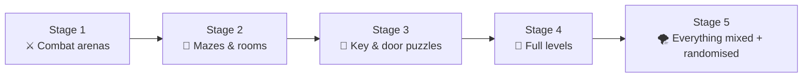

# 4. Training Plan

> **One line:** The agent plays thousands of games and gets points for good things and penalties for bad things. It starts on easy maps and moves to hard ones.

---

## 4.1 How learning works (plain words)

1. The agent plays.
2. We write down **what it saw, what it did and what reward it got**.
3. **PPO** (our learning algorithm) nudges the brain: *"do more of what led to good rewards, less of what led to bad ones"*. It takes small, safe steps so learning doesn't fall apart.
4. Repeat millions of times.

### Our PPO setup (starting values)

| Setting | Value | Meaning |
|---------|-------|---------|
| Parallel games | 16–64 | More games = faster data collection |
| Steps per game per round | 128 | How much each game plays before learning |
| Memory sequence length | 32 | How many steps the GRU learns across |
| Discount (γ) | 0.995 | How much the agent cares about the future (long levels → high) |
| GAE λ | 0.95 | Smooths reward estimates |
| Clip | 0.2 | Keeps updates small and safe |
| Learning rate | 3e-4 → decays | Step size |
| Entropy bonus | 0.01 → 0.001 | Encourages trying new things early |

We write PPO **ourselves** (not a default Stable-Baselines3 script). This is required for innovation points, and it lets us add the manager, the curiosity reward and the asymmetric critic.

---

### Speed and robustness for long runs

Learned the hard way during the first 6M-step run, now built into `training/rollout.py` / `training/train.py`:

1. **Windows timer:** game workers ask for 1 ms timer resolution (`timeBeginPeriod(1)`). Without it, lockstep stepping is ~10× slower on Windows (Linux/macOS are unaffected).
2. **Fewer map loads:** a map load takes ~0.6 s and stalls every game in the batch, so each map is reused for `--switch-every 8` episodes (was 2).
3. **Bad maps are skipped**, not fatal: a map that fails to build or load is logged and another one is picked.
4. **`--resume`** continues a run from `latest.pt` + `train_state.pt` (optimizer, reward scale, step count, curriculum progress).

Measured on our 20-core Windows laptop (stage 3, memory on, 4 workers × 4 games): **~110 → ~375 steps/s** (≈1.35M steps/hour).

### Warm start: add memory without starting over

A memory brain only adds inputs at the end of two layers (mind map → `fuse`, notebook → `gru`). `--warm-start <brain without memory>` copies every shared weight and sets the new memory inputs to **zero**, so the memory brain starts out playing **exactly** like the source brain (tested) and only has to learn to use memory (`training/warmstart.py`).

```bash
uv run python -m training.train --stage 3 --memory on --warm-start submission/weights/champion.pt     --puzzle-share 0.6 --ticks 3500 --workers 8 --games 2 --steps 4500000 --name p3-mem-ws-v1
```

`--puzzle-share 0.6` keeps 40% of games on older maps (default 20%) so a strong starting brain doesn't forget arenas and mazes; `--ticks 3500` matches the Tier 3 time limit (backtracking takes time). On our laptop 8 workers × 2 games (~450 steps/s) beat 4 × 4 (~356).

## 4.2 Rewards: mirror the official scorer

Rule of thumb: **reward what the scorer rewards**, plus a few helpers.

| Event | Reward (start value) | Why |
|-------|----------------------|-----|
| 🏁 Reach exit | **+10** (+ bonus for health and time left) | Biggest scorer bucket |
| 🔑 Pick up keycard | **+3** | Progression |
| 🔓 Unlock locked door | **+3** | Progression |
| 🚪 Open normal door | **+1** | Progression |
| 🗺️ Visit a new area cell | **+0.05** | Exploration bucket |
| ⚔️ Kill enemy | **+1** | Combat bucket |
| 💊 Pick up health/ammo when low | +0.2 | Survival |
| 🩸 Take damage | −0.02 per HP | Scorer penalty |
| 💀 Die | **−5** | Scorer penalty |
| ⏱️ Every step | −0.001 | Don't waste time |
| 🧱 Stuck (barely moved for ~2 s) | −0.1 | Get out of corners |
| 🔫 Shooting at nothing | −0.01 | Save ammo |
| 🔁 Door bounce (pressing `USE` again on a moving door) | −0.05 | Doors reverse if you spam `USE` |

**How we detect these during training:** the official `env.privileged_state()` gives the true position, kills and damage. Key flags come from `vitals`, and door/sector state comes from the engine. None of this privileged information goes to the game-day agent; it's only used to **calculate rewards**.

> The wrapper's built-in `reward` (+1 exit, −1 death, +0.1 per kill) is only a convenience and **not** the evaluation score. We replace it with the table above.

**Speed tip:** `make_env(..., render_buffers=False)` skips the RGB and depth images. We use it in stages that don't train the image encoders, which makes training much faster.

---

## 4.3 Curiosity: wanting to see new places

The scorer pays for exploration, and curious agents don't get stuck. We use two kinds of curiosity:

| Type | How it works | Cost |
|------|--------------|------|
| **Count-based novelty** | Bonus = 1 / √(times visited this cell). New places pay a lot, old places pay little. | Very cheap |
| **RND (Random Network Distillation)** *(stretch)* | A small network tries to predict a random fixed network's output. Things it can't predict well are "new" and earn a bonus. | Cheap |

The curiosity bonus **shrinks over training** so the agent ends up focused on the real goals.

---

## 4.4 Curriculum: easy → hard



| Stage | Maps | Training helpers (allowed in training only) | Graduate when |
|-------|------|---------------------------------------------|---------------|
| **1. Combat** | Small arenas, ViZDoom-style scenarios (defend the center, deadly corridor) | Infinite ammo at first, then removed | Survives + kills reliably on held-out arenas |
| **2. Navigation** | Generated mazes and multi-room maps | Few or no monsters; doors open automatically at first | Explores most of held-out maps |
| **3. Key puzzles** | Small maps: key in one branch, locked door in another, exit behind it | Key placed close at first, then farther away | Picks up the key + unlocks the door on most held-out maps |
| **4. Full levels** | OBLIGE-generated levels, Freedoom levels, community WADs | None | Regularly reaches the exit on held-out levels |
| **5. Mix** | All stages mixed together + randomisation | None | Champion score stops improving |

**Stage 3 as built (`training/curriculum.py`):** 80% puzzles, 20% replay (rooms 60%, maze 20%, arena 20%). The puzzle share starts as 100% `keynear` (2–4 rooms, key in or next to the start room, ≤ 2 monsters) and moves linearly to 30% `keynear` / 70% `keydoor` by the end of the run. Training maps are generated on demand from seeds < 100,000 into `maps/generated/`; held-out Tier 3 maps are `maps/curated/{val,test}/t3-{keydoor,keynear}-*`.

```bash
uv run python -m training.train --stage 3 --memory on  --name s3-mem   --steps 2000000 --workers 6 --games 4
uv run python scripts/ablation.py run --name abl --steps 2000000      # both arms + held-out report
```

**Important:** we **keep replaying old stages** (about 20% of games) so the agent doesn't forget earlier skills.
**Final evaluation runs on the normal game**, so the last stages must use **no helpers at all**.

---

## 4.5 Map library

| Source | What we get | Notes |
|--------|-------------|-------|
| **OBLIGE / ObAddon** (procedural generator) | Unlimited full levels with keys, locked doors and exits | ⭐ Best source of variety |
| **Freedoom Phase 1 & 2** | Classic hand-made levels | Free, matches the eval IWAD |
| **Community WADs** | Many styles | Check licences |
| **Our own procedural maps** ✅ | Arenas (T1), mazes (T2), doored rooms (T2), key-door puzzles (T3), unlimited and reproducible from a seed | `training/mapgen/` + `scripts/generate_maps.py` (see below) |
| **Template test map** | `maps/two_rooms.wad` | For smoke tests only (not an eval map) |

**Map rules from the contract:**
- `make_env("my.wad", "MAP07")` loads any ViZDoom-compatible WAD (Doom, Boom, Hexen, UDMF).
- Skip maps with **more than 2,048 sectors**: rays and line-of-sight break beyond that, and evaluation maps stay under the limit.
- Dry-run any map with `python validate.py --map path/to/my.wad:MAP01`.

### Our map generator (`training/mapgen/`)

1. **Text drawing → map** (`udmf.py`): one character per 64-unit cell (`#` wall, `.` floor, `P` start, `D` door, `R/B/Y` locked door, `r/b/y` keycard, `X` exit pad, `z s i d` monsters, `h a A S` items). It writes UDMF, the format of the template's own maps; doors face outward so the engine and `doom_env` both recognise them.
2. **Seeded layouts** (`layouts.py`): `arena`, `maze`, `rooms`, `keydoor`. In `keydoor` the exit room is a leaf behind a locked door and the key sits in another branch (not next to the door when possible), so the agent must **remember the door and backtrack**.
3. **Seed ranges never overlap:** training 0–99,999 (`maps/generated/`, git-ignored, rebuild any time); val 100,000+ and test 200,000+ (`maps/curated/val|test/`, committed via Git LFS, 4 maps per kind each).

```bash
uv run python scripts/generate_maps.py --set train --count 50 --check   # training maps
uv run python scripts/build_map_catalog.py                              # refresh maps/lists/
```

### Split (never mix these!)

| Split | Share | Used for |
|-------|-------|----------|
| **Train** | ~80% | Learning |
| **Validation** | ~10% | Picking the champion checkpoint |
| **Test (locked)** | ~10% | Final honest score only. Never used to make decisions. |

### Randomisation (to generalise)
Random spawn points, random seeds, different monster types, different textures and lights, different difficulty levels, and **always include skill 3 with `freedoom2.wad`** (the eval setting). We vary the episode length between **2,100 and 4,200 ticks**, like the real maps.

### Repo size
WAD files can be big. We **commit the generator configs and scripts**, plus only a small set of WADs (via LFS). Maps are generated locally before training.

---

## 4.6 Teacher–student training (stretch goal)

1. Train a **teacher** that is allowed to see privileged information (true position, full map layout). It learns fast.
2. Train the **student** (our real agent, ego-view only) to **copy the teacher's actions**, then fine-tune it with PPO.

The final agent is still **100% a neural network using only official observations**, so this is within the rules, and it's a strong innovation story.

---

## 4.7 Extra learning helpers (auxiliary tasks)

Small extra "homework" questions the brain answers during training. They speed up learning:

- "Which direction is the nearest unvisited area?"
- "Is there an enemy behind me?" (from memory)
- "How much did I turn this step?" (helps the odometer, because turning isn't observed)
- "Is the exit in view, and which way?" (teaches the RGB encoder to spot exits, since rays and entities never show the exit)
- "What colour is that key or locked door?" (from the map data during training)

They're removed (or simply unused) on game day.

---

## 4.8 Checkpoints and the champion

- Save a checkpoint every N updates.
- Every checkpoint plays the **validation maps** in the Mini-League (see [Testing Plan](05-TESTING-PLAN.md)).
- If it beats the champion's score → **it becomes the new champion** → copy it to `submission/weights/` (Git LFS) through a pull request.
- Keep the last 3 champions in case a regression appears later.

## 4.9 Experiment tracking

- **TensorBoard** logs: reward per bucket, episode length, exit rate, kills, deaths, area explored, losses, steps per second.
- Every run gets a name: `stage{N}_{short-idea}_{date}`, e.g. `stage3_notebook-v2_1127`.
- Every run saves its **config file** next to its checkpoints so it can be reproduced.
- Notes on what we tried and learned go into `docs/experiments.md` (one line per run).


Stage 4 is implemented through `training/map_pool.py` and `MapSampler`: usable train Tier 4 Freedoom2 entries only, default 80% full levels plus generated replay, catalog episode caps, canonical identity leakage checks and checkpointed pool provenance. See `training/README.md` for flags and `scripts/phase4_ablation.py` for matched held-out comparisons. Scientific completion still requires improved Tier 3/4 exit rates; the recorded short smoke does not demonstrate this.
