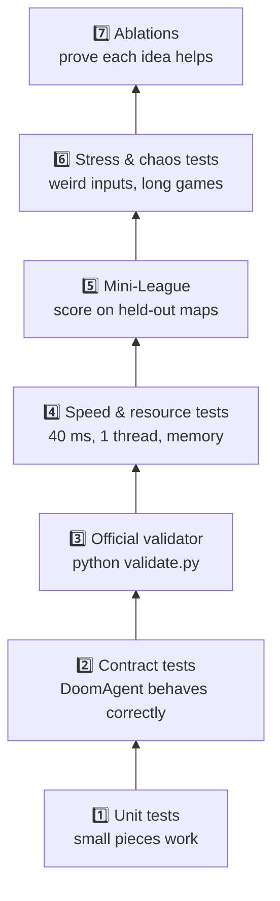

# 5. Testing Plan

> **One line:** Prove the agent works on maps it has never seen, never crashes and is always fast enough, before the organisers check.

---

## 5.1 The testing ladder



Lower steps are fast and run often. Higher steps are slower and run on important checkpoints.

---

## 5.2 Level 1: Unit tests (`tests/agent/unit/`)

The template's own tests stay in `tests/`. Ours go in `tests/agent/` so the two never mix.

Small, fast checks on each building block.

| Test | Checks |
|------|--------|
| Ray encoder | Output shape is right; rotating the rays rotates the result in a sensible way |
| Entity encoder | Works with 0, 1 and 30 entities; empty slots change nothing |
| Odometer | Replay a recorded path → position error < 1% of distance, heading error < 0.1° (baseline from `configs/odometry.json`) |
| Mind map | A ray hitting a wall marks the right cell; the visited cell is marked |
| Notebook | Seeing the same locked door twice updates **one** slot, not two |
| Action head | Always produces a valid action in the official format |
| Reward calculator | A fake "key picked up" event gives +3, etc. |

## 5.3 Level 2: Contract tests (`tests/agent/contract/`)

| Test | Checks |
|------|--------|
| Interface | `DoomAgent(observation_space, action_space, device)` builds without error |
| Load once | Weights load in `__init__`, not on every `act()` |
| Reset clears memory | After `reset()`, mind map / notebook / GRU are all empty |
| Valid actions | 1,000 random observations → 1,000 actions of shape `(9,)` with values in `{0, 1}` |
| Weights path | Weights load relative to `submission/` (`Path(__file__).parent`), not the working directory |
| No forbidden access | `submission/` imports nothing from training-only code (rewards, cheats, privileged info) |
| No network | Agent works with networking disabled |
| Read-only repo | Agent never writes files inside the repo |

## 5.4 Level 3: Official validator

```bash
uv run python validate.py                              # quick, local
uv run python validate.py --map maps/my.wad:MAP01      # dry-run on our own map
python validate.py --docker --image devforge-doom      # inside the official image (closest to the scorer)
```

It checks:
1. Repo size ≤ 1 GB (including LFS), and that **nothing under `submission/` is git-ignored, untracked or uncommitted**.
2. `DoomAgent` imports and runs; `requirements.txt` follows the rules; every package `submission/` imports is in the image or in `requirements.txt`.
3. A full episode runs without crashing and with valid actions.
4. Init time, per-step time and per-map compute time, with the agent **pinned to one CPU core**.
5. Peak RAM ≤ 8 GB and peak GPU memory ≤ 2 GB.

**Rule:** nothing gets merged to `main` if `validate.py` fails. The template's own tests (`uv run pytest`) must also keep passing.

## 5.5 Level 4: Speed & resource tests (`scripts/benchmark_latency.py`)

| Check | How | Pass if |
|-------|-----|---------|
| Average decision time | `OMP_NUM_THREADS=1`, `torch.set_num_threads(1)`, 1,000 steps | **< 20 ms** (our target); total per map must stay under 40 ms × steps |
| Worst decision time | Same run | < 5 s (hard limit), ideally < 100 ms |
| First `act()` (warm-up) | Fresh map | < 10 s |
| Load time | Fresh process | < 60 s |
| RAM | Peak memory | < 8 GB (target < 2 GB) |
| GPU memory | If using CUDA | < 2 GB |
| Repo size | `git count-objects` + LFS | < 1 GB |

We also run it on a **slow laptop** as a worst case.

## 5.6 Level 5: The Mini-League ⭐ (`scripts/evaluate.py`)

```bash
uv run python scripts/build_map_catalog.py                          # once, or after adding maps
uv run python scripts/evaluate.py --split val --seeds 2 --name my-run
uv run python scripts/evaluate.py --split val --seeds 2 --jobs 8 --name my-run   # same scores, ~13x faster
```

Map tiers and tick caps come from `maps/catalog.json` (a heuristic: locked doors + keys → Tier 3/4, doors or many sectors → Tier 2, else Tier 1). The scorer lives in `training/scorer.py`; its weights are our guesses (Decision D-17).

Our own copy of the hidden evaluation.

- **Maps:** validation (and, at the very end, test) maps only. **Never training maps.**
- **4 tiers**, like the real one:
  - Tier 1 Combat & Survival
  - Tier 2 Multi-room Exploration
  - Tier 3 Keycard → Locked door → Exit
  - Tier 4 Full gauntlet
- **Settings:** Freedoom 2, **skill 3**, fixed seeds, tick cap of **2,100–4,200** like the real thing.
- **Our scorer** copies the official buckets: exit (biggest), progression, exploration (we track visited areas using the true position), combat minus damage/death.
- **Tier weights:** higher tiers count more (e.g. 1×, 2×, 3×, 4×; adjust if the template reveals real values).

**Output:** a score table per tier + per bucket, saved as a file and shown in TensorBoard:

| Checkpoint | T1 | T2 | T3 | T4 | Weighted total | Avg ms | Crashes |
|------------|----|----|----|----|----------------|--------|---------|
| champion   | …  | …  | …  | …  | …              | …      | 0       |
| challenger | …  | …  | …  | …  | …              | …      | 0       |

**Champion rule:** a new checkpoint replaces the champion only if its weighted total is higher **on the same map set** (same maps and seeds as the champion's stored score) **and** it has 0 crashes **and** its speed is within budget. `scripts/export_champion.py` enforces all three and checks each result was made with the right weights.

## 5.7 Level 6: Stress & chaos tests (`tests/agent/stress/`)

✅ **Built** (`tests/agent/stress/test_stress.py`, 11 tests, ~50 s). Chaos observations, a 32-enemy view, and `act()` before `reset()` / double resets run against all four brain types: random fallback, the Phase 2 champion, a Phase 3 memory brain and a full Phase 4 brain (memory + manager + RGB + depth). Chaos covers 600 observations each (NaN/inf, huge values, wrong shapes, missing keys, wrong types, out-of-range ids, non-dict input). The back-to-back maps test covers memory and phase4: full episodes on a closet spawn, an empty map and a 14-monster crowd in a row. A one-off soak (full Phase 4 brain, 20 val maps × 4,200 ticks) stayed at 3.8–4.4 ms per decision with flat memory (~70 MB) and 0 fallbacks.

| Scenario | Expected |
|----------|----------|
| Feed NaN / empty / huge values | Returns a valid safe action, no crash |
| 4,200-tick game, 20 maps in a row | No slowdown, no memory growth |
| `reset()` called twice in a row | Fine |
| Spawn facing a wall / inside a tiny closet | Gets out |
| Many enemies at once (15+) | Still fast, still valid |
| Map with no enemies / no keys | Still explores |
| Different random seeds | Score doesn't swing wildly |

## 5.8 Level 7: Ablations (proof for judges)

Turn off one idea at a time and re-run the Mini-League:

| Version | What's removed | We expect |
|---------|----------------|-----------|
| Full Smriti | — | Best |
| − Mind map | No grid memory | Worse at exploring (Tier 2) |
| − Notebook | No landmark slots | Much worse at keycard puzzles (Tier 3) |
| − Manager | Single flat policy | Worse at long levels (Tier 4) |
| − Curiosity | No novelty reward | Gets stuck more, explores less |
| − Curriculum | Train only on full levels | Learns slower / worse |

The results go into the **2-page brief** and the **demo** as a simple bar chart.

## 5.9 Manual / visual checks

- Record **videos** of the agent on validation maps (with the Mind View overlay).
- Watch for silly behaviour: spinning, wall-hugging, shooting walls, ignoring keys.
- Write each observed problem into `docs/experiments.md` as a todo.

## 5.10 When each test runs

| When | Tests |
|------|-------|
| Every code change (before commit) | Unit + contract |
| Every merge to `main` | Unit + contract + `validate.py` + speed |
| Every new checkpoint | Mini-League (validation maps) |
| Before the final submission | Everything + test-map Mini-League + ablations + fresh-clone validator run |

## 5.11 Final submission checklist (test-side)

- [ ] Fresh `git clone` of the public repo → `python validate.py --docker` passes
- [ ] `git lfs ls-files` lists the champion weights, and a fresh clone downloads them (not LFS pointer files)
- [ ] The final commit is on the **default branch** (`main`), which is what the scorer evaluates
- [ ] Speed benchmark < 20 ms average on 1 thread
- [ ] 0 crashes in the full Mini-League
- [ ] Repo ≤ 1 GB


## Phase 5 execution notes

`tests/agent/stress/test_chaos.py` exercises malformed/extreme observation cleaning and reset contracts. `scripts/stress_agent.py` measures real generated-map runs (default 20 maps, 4200-tick caps), behavioral displacement, fallbacks, latency and supported RSS growth. It reports unsupported measurements separately; passing short/unit checks is not full §5.7 acceptance. `scripts/generalisation.py` produces strict matched-tier validation/final-test reports and threshold-based comparisons. Preserve the test-use ledger across runs; first-ever historical test exposure cannot be guaranteed.
