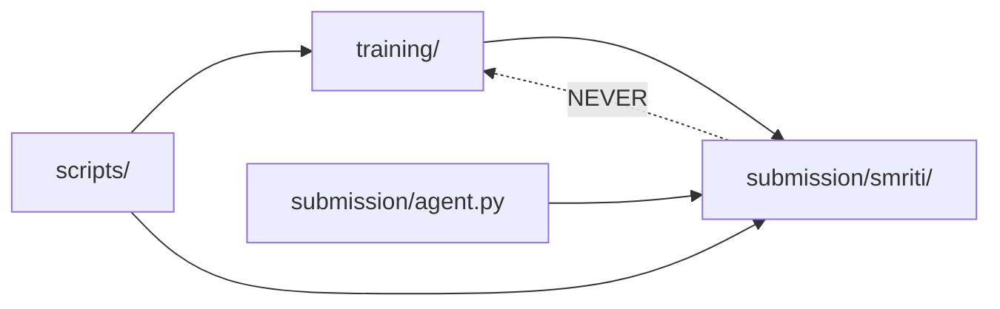
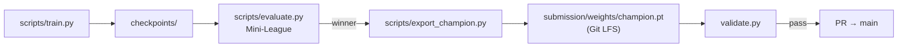

# 6. Repo & Workflow

> **One line:** Where every file lives, how we set up the repo, and how we work together without breaking things.

---

## 6.1 Setting up (step by step)

> The repo is built on the official [`devforge-doom-template`](https://github.com/Reinforce-SST/devforge-doom-template), as the rules require.

1. Clone: `git clone https://github.com/Ayush-Patel-56/ak-doom.git`
2. Install Git LFS once: `git lfs install`
3. Install [uv](https://docs.astral.sh/uv/), then run `uv sync` (Python 3.13, vizdoom, gymnasium, official wrapper)
4. Check that everything works: `uv run python validate.py` and `uv run pytest`
5. Optional but recommended: install Docker, then `docker build -t devforge-doom .` and `python validate.py --docker --image devforge-doom`
6. Read the official docs: [CONTRACT.md](CONTRACT.md), [RULES.md](RULES.md), [SUBMISSION.md](SUBMISSION.md), [EVALUATION.md](EVALUATION.md)

**Platforms:** Linux, Apple Silicon Macs and Windows (x86-64) all work. Intel Macs need Docker or Linux. Evaluation runs on Linux, so `--docker` is the closest check.

**Windows notes (found in Phase 0):**
- Set `PYTHONUTF8=1` (PowerShell: `$env:PYTHONUTF8 = "1"`). Without it, `validate.py` crashes printing its ✓ marks.
- `validate.py` warns that it can't pin the agent to 1 CPU or measure RAM on Windows. Use `--docker` for real numbers.
- The official image is big: about **19 GB** on disk, and the first build downloads several GB (PyTorch, JAX, CUDA libraries). Later runs reuse it.
- Even in Docker, Windows can't report per-process GPU memory (`validate.py` warns). Measure it on a Linux GPU machine once the agent uses the GPU.
- **GPU training on Windows (optional).** The project's `.venv` has the CPU build of PyTorch (that is what the agent uses at evaluation). For training on an NVIDIA GPU, make a *separate* environment outside the repo so `uv.lock` and the submission never change:
  ```powershell
  uv export --frozen --no-hashes --no-emit-project --format requirements-txt | Select-String -NotMatch '^torch==' | Out-File -Encoding utf8 gpu-req.txt
  uv venv F:\venvs\ak-doom-gpu --python .venv\Scripts\python.exe
  uv pip install --python F:\venvs\ak-doom-gpu\Scripts\python.exe -r gpu-req.txt
  uv pip install --python F:\venvs\ak-doom-gpu\Scripts\python.exe torch==2.15.0 --index-url https://download.pytorch.org/whl/cu132
  F:\venvs\ak-doom-gpu\Scripts\python.exe -m training.train --device cuda ...
  ```
  `torch 2.15.0+cu132` ran on an RTX 4050 Laptop with a CUDA 13.0 driver (581.80). Phase 4 (RGB encoder + manager) trained at ~380 decisions/s vs ~255 on the CPU, using < 1 GB of GPU memory; `--resume` moves a CPU run onto the GPU.
- 8 template tests fail on Windows because they use Linux-only Python features (`resource`, `os.sched_getaffinity`). The other 41 pass. They are expected to pass on Linux/Docker.

## 6.2 Folder layout

Files from the template are marked 🟦 (**don't edit** unless the organisers release a fix). Our files are marked 🟩.

```text
ak-doom/
├── README.md                      🟩 project overview (replaces the template README)
├── validate.py                    🟦 official validator
├── Dockerfile, docker/            🟦 official base image (don't submit our own)
├── pyproject.toml, uv.lock        🟦 environment (we add our dev dependencies here)
├── env/doom_env/                  🟦 official wrapper + limits.py (the scorer ignores our copy)
├── docs/
│   ├── CONTRACT.md, RULES.md,     🟦 official docs
│   │   SUBMISSION.md, EVALUATION.md
│   ├── 01-PRD.md … GLOSSARY.md    🟩 our planning docs
│   └── experiments.md             🟩 one line per training run
│
├── submission/                    WHAT THE ORGANISERS RUN
│   ├── agent.py                   🟦→🟩 DoomAgent + safety wrapper (we replace the random baseline)
│   ├── requirements.txt           🟩 extra packages, pinned (probably empty)
│   ├── smriti/                    🟩 the brain
│   │   ├── encoders/              ray, entity, vitals, depth, rgb
│   │   ├── memory/                odometer, mind_map, notebook
│   │   └── policy/                brain, manager, worker, action_head
│   └── weights/champion.pt        🟩 Git LFS
│
├── training/                      🟩 FACTORY ONLY (never imported by submission/)
│   ├── README.md                  how to train
│   ├── ppo.py                     our PPO
│   ├── rollout.py                 parallel game runner
│   ├── rewards.py                 reward calculator (uses privileged_state)
│   ├── curiosity.py               novelty bonus / RND
│   ├── curriculum.py              stage logic
│   ├── critic.py                  asymmetric critic (training only)
│   ├── scorer.py                  Mini-League scorer ✅
│   └── mapgen/                    map generator ✅: udmf.py (drawing → WAD), layouts.py (arena/maze/rooms/keydoor)
│
├── maps/
│   ├── two_rooms.wad              🟦 template test map
│   ├── catalog.json               🟩 every map: sectors, doors, keys, tier, split
│   ├── lists/{train,val,test}.txt 🟩 which maps are in which split
│   ├── curated/{val,test}/        🟩 fixed generated eval maps (Git LFS)
│   └── generated/                 🟩 training maps from scripts/generate_maps.py (git-ignored)
│
├── configs/                       🟩 YAML per stage/experiment
├── scripts/                       🟩 entry points
│   ├── agent_loader.py            loads DoomAgent exactly like the scorer (+ one-thread limits)
│   ├── map_spec.py                "wad:MAP01" parsing, "@vizdoom/..." portable paths
│   ├── build_map_catalog.py       map library + train/val/test lists
│   ├── evaluate.py                Mini-League
│   ├── generate_maps.py           procedural maps → maps/curated or maps/generated
│   ├── benchmark_latency.py       speed vs. official limits
│   ├── inspect_observation.py, measure_odometry.py   (Phase 0 tools)
│   └── (later) train.py, record_video.py, export_champion.py
├── dashboard/                     🟩 Mind View (demo only)
└── tests/
    ├── test_env.py, ...           🟦 template tests
    └── agent/                     🟩 our tests: unit/, contract/, stress/
```

### Why the brain lives inside `submission/`
The contract says weights load **relative to `submission/`**, and the validator checks every package that `submission/` imports. Keeping the brain in `submission/smriti/` means the scorer can always import it, and training imports the **same code**, so there's no copying and no drift.

### The golden rule of imports



`submission/` may only use its own code plus torch/numpy/opencv (in the base image). A contract test enforces this.

## 6.3 Git LFS and size budget

The template's `.gitattributes` already sends `*.pt`, `*.pth`, `*.safetensors`, `*.ckpt`, `*.npz`, `*.onnx` (and more) to LFS. We add one line for our curated maps (not all WADs, so the template's test WADs stay as they are):

```text
maps/curated/** filter=lfs diff=lfs merge=lfs -text
```

`.gitignore` additions (never ignore anything under `submission/`; the validator fails if we do):

```text
runs/            # TensorBoard logs
checkpoints/     # all non-champion checkpoints
maps/generated/  # generated maps (rebuilt by script)
videos/
```

| Item | Budget |
|------|--------|
| Champion weights | < 50 MB |
| Curated WADs | < 200 MB |
| Everything else | < 100 MB |
| **Total** | **well under 1 GB** |

The scorer only fetches the evaluated commit and the LFS files it references, so old weight versions don't count. Weights committed **without** LFS do count, so always use LFS.

## 6.4 Branches and pull requests

**No direct commits to `main`.** Every change goes through a pull request.

| Branch | Purpose | Rule |
|--------|---------|------|
| `main` | Always submittable. The scorer evaluates its last commit at the deadline. | Changes only via PR; `validate.py` + tests must pass |
| `feat/<name>` | New feature, e.g. `feat/notebook` | Merge by PR |
| `exp/<name>` | Risky experiment | May never be merged |
| `fix/<name>` | Bug fix | Small, fast |
| `docs/<name>` | Documentation | Merge by PR |

## 6.5 Commits

Short and clear, using a type prefix:
```text
feat: add circular ray encoder
fix: clear notebook in reset()
exp: try 64-cell mind map crop
docs: update training plan rewards
test: add latency benchmark
```

## 6.6 Definition of Done (for any task)

A task is done only when:
- [ ] Code is written and readable (short functions, clear names)
- [ ] Tests added and passing (`uv run pytest`)
- [ ] `uv run python validate.py` still passes
- [ ] Speed still within budget (if it touches the brain)
- [ ] Docs updated if the design changed
- [ ] Merged to `main` via pull request

## 6.7 Coding style (simple rules)

- Python 3.13, type hints on public functions.
- Formatting with `ruff format`, linting with `ruff check`.
- **All numbers live in `configs/*.yaml`**, not buried in code.
- One module = one job (see the table in [System Design §3.7](03-SYSTEM-DESIGN.md#37-main-code-modules-planned)).
- Comments explain **why**, not what.
- The agent prints very little: organisers can read stdout/stderr logs.

## 6.8 Weights flow


