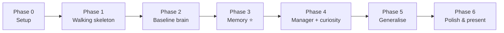

# 7. Roadmap

> **One line:** Build in layers. Every phase ends with an agent that is **submittable**, so we always have something to hand in.

No dates here, only order. Each phase has a clear **"Done when"**.

> 💡 **Start training early.** Training takes the longest, so get Phase 2 training running as soon as possible and build Phases 3–4 while it runs.

---

## Phase 0 — Setup

- [x] Repo `ak-doom` on GitHub, built on the official template
- [x] Read `CONTRACT.md` → facts recorded in the [PRD §1.9](01-PRD.md#19-contract-facts-answered-by-the-official-template)
- [x] Planning docs merged (PR #1)
- [x] Setup works on Windows (`uv sync`, `validate.py` passes; see §6.1 for Windows notes). Every team member: [Repo & Workflow §6.1](06-REPO-AND-WORKFLOW.md#61-setting-up-step-by-step) (`uv sync`, `validate.py`, `pytest`)
- [x] Build the Docker image and run `validate.py --docker` once: **passed** on `main` after Phase 1 (1 CPU pinned, 44 MB RAM, ~0.4 ms per step)
- [x] Run the test map and **print one full observation** (`scripts/inspect_observation.py`)
- [x] Calibrate the odometer (`scripts/measure_odometry.py` → `configs/odometry.json`): turn model; production-estimator drift is **3.85%** on `two_rooms.wad` (seed 1 in `configs/odometry.json`). Held-out seed 733, 600 steps per map: final position drift is **0.40%** on `two_rooms.wad`, **0.68%** on the Tier 2 maze, and **4.02%** on the Tier 3 key/door map (see System Design §3.3.1 and `configs/odometry-validation.json`)
- [x] Add `.gitignore` lines and the `maps/curated/**` LFS rule
- [x] Protect `main` on GitHub: require a pull request before merging

**Done when:** everyone can run a game locally, and `main` only changes through PRs.

---

## Phase 1 — Walking skeleton (a submittable agent)

- [x] `submission/agent.py` keeps the template's random baseline, plus the safety wrapper (`submission/smriti/safety.py`)
- [x] `submission/smriti/` package wired into `agent.py` (random policy in `smriti/policy/`)
- [x] Contract + unit tests (`tests/agent/`, 30 tests) and `validate.py` passing
- [x] First version of `scripts/evaluate.py` (Mini-League; scorer in `training/scorer.py`)
- [x] First version of `scripts/benchmark_latency.py`
- [x] Map tools: `scripts/build_map_catalog.py` → `maps/catalog.json` + `maps/lists/{train,val,test}.txt` (Freedoom 2 + ViZDoom scenarios, 45 maps)
- [x] Our own small Tier 1/2/3 maps for val/test (`training/mapgen/`, 16 val + 16 test maps)
- [ ] OBLIGE generated full levels (needs a separate install; optional, see Training Plan §4.5)

**Done when:** a random agent passes the validator and gets a (low) Mini-League score. **We have a baseline.**

---

## Phase 2 — Baseline brain + our PPO

- [x] Ray, entity (attention) and vitals encoders (`submission/smriti/brain.py`)
- [x] GRU memory (256)
- [x] Simple flat policy (6 action groups → 9 buttons) + critic; `BrainPolicy` in the agent, random fallback without weights
- [x] Our recurrent PPO + parallel game runner (`training/ppo.py`, `training/rollout.py`)
- [x] Reward calculator (§4.2) + helpers (`training/rewards.py`)
- [x] Curriculum Stage 1 (combat) and Stage 2 (navigation) (`training/curriculum.py`); first 6M-step run: val **+2,021** vs random −201
- [x] TensorBoard logging + checkpoint → Mini-League → champion export (`scripts/export_champion.py`); `--resume` for long runs
- [x] First champion exported (`p2-stage12-v1` final, +2,021 on val): `submission/weights/champion.pt` + `champion.json`; passes `validate.py --docker` (init 7.4 s, 1.2 ms per decision, 968 MB RAM)

**Done when:** the champion clearly beats random on Tier 1 and Tier 2 validation maps and stays within the speed budget.

---

## Phase 3 — Memory system ⭐ (our USP)

- [x] Odometer (+ real-engine training-ground-truth tests; measured drift and limitations in System Design §3.3.1)
- [x] Mind map (grid update + rotated crop + small CNN): `smriti/memory/mindmap.py`, `MapEncoder`
- [x] Landmark notebook (slots + attention from the GRU state): `smriti/memory/notebook.py`, `NotebookReader`
- [x] Curriculum Stage 3 (key & door puzzles): `training/curriculum.py`, new `keynear` layout (key near spawn → far `keydoor` over the run, 20% replay), 4 + 4 held-out `t3-keynear` val/test maps
- [x] Ablation pipeline: with vs without memory (`scripts/ablation.py`, `--memory on|off`); first short CPU run logged in `docs/experiments.md`. A long GPU run is still needed for the *Done when* criterion
- [x] Long Phase 3 training run: `p3-mem-ws-v1` (memory on, warm-started from champion #1, 4.5M steps, 40% replay) → **champion #2: +5,182.69 vs +2,511.03** on the 24-map val, better on every tier

**Done when:** the agent picks up keycards and opens matching locked doors on held-out Tier 3 maps, and the ablation shows memory helps.

✅ **Met for keycards/locked doors:** champion #2 picks up the key, opens the locked door and exits on **all 4 held-out `keynear` maps** (both seeds) and on 1 of 4 far-key `keydoor` maps; the ablation (one seed) shows memory helps. Next: more seeds for the ablation, and far-key maps.

---

## Phase 4 — Manager/worker + stronger curiosity

- [x] Manager (5 learned goals, every 8 decisions) + goal-conditioned worker; implementation/smoke verified
- [x] Goal helper rewards (training-only scorer events)
- [x] RND curiosity (optional; checkpointed predictor/target/statistics)
- [x] RGB encoder + masked "exit in view?" auxiliary task (real geometry/render labels; detector effectiveness not established)
- [x] Optional real-depth encoder; measured Mac latency in configs/depth-stage4-smoke.json
- [x] Curriculum Stage 4 (catalog train-only full levels, replay and recorded caps)
- [x] Controlled ablation runner: − manager, − curiosity, Phase 3 reference; smoke execution verified

- [x] Warm start from champion #2 keeps its policy when the manager is added (D-31, PR #23)
- [x] GPU training (RTX 4050, separate CUDA environment; Repo & Workflow §6.1): ~380 vs ~255 decisions/s on CPU
- [x] Two training runs from champion #2 (`docs/experiments.md`): run 1 (50% full levels, curiosity 0.01) **forgot** key puzzles (+3,345 at 500k); run 2 (conservative mix) reached **+5,354.56** on 2 seeds but **+5,077.05 vs champion #2's +5,308.52 on 4 seeds**

**Done when: not met.** Phase 4 matches Phase 3 within noise but does not add Tier 3/4 exits (T3 20/36 vs 21/36, T4 0/12 both, 4 seeds). Champion #2 stays the submitted brain (D-32). Next, if time allows: a longer run from `p4-cons-ws-v2` and a larger seed sample before any export.
The 512-decision smoke comparison had zero exits in every arm; improvement is not established.

---

## Phase 5 — Generalise and harden

- [x] Stage 5: mixed train-only catalog and versioned randomised generated maps
- [x] Broader training tiers and full training seed namespace
- [x] Optional frozen legal-observation teacher distillation (privileged teacher deferred)
- [x] Optional real-transition dynamics auxiliary task (terminal/reset masked)
- [x] Automated stress & chaos coverage: `tests/agent/stress/` (4 brain types), upstream 20-map soak, and Phase 5 real-engine stress measurements in `configs/phase5-smoke.json`
- [ ] Full §5.7 acceptance: platform resource and policy-quality criteria still require evidence; passing robustness tests does not establish gameplay skill
- [x] CPU speed <20 ms average: champion #2 averages **4.6 ms** per decision on the 24 val maps × 4 seeds (one thread) and **p50 2.2 ms** in `validate.py --docker` (1 CPU pinned, fresh clone of `main`)

**Done when (still open):** useful performance on locked **test maps** is close to validation under declared acceptance thresholds and sufficient samples. Development does not run test maps; future test use is ledgered, historical freshness is unknown.

---

## Phase 6 — Polish & present

- [x] Final champion exported + fresh-clone `validate.py --docker` check: champion #2 (Phase 3), fresh clone of `main` passed in Docker (init 6.3 s, p50 2.2 ms, exit in 82 steps, 668 MB)
- [ ] Final PR merged to `main` **before the deadline** (the scorer evaluates the last commit on the default branch)
- [x] Mind View dashboard: `scripts/mind_view.py` (records the real agent's map, notebook, goal and attention to MP4)
- [x] Demo videos (good runs + honest failure cases): 6 recordings in `docs/demo/` ([list](08-DEMO-AND-BRIEF.md#81-mind-view-dashboard))
- [x] Ablation chart + results charts: `docs/figures/` (`scripts/make_charts.py`)
- [x] 2-page brief PDF ([outline](08-DEMO-AND-BRIEF.md#82-the-2-page-brief-outline)): `docs/brief/brief.pdf`; team names still to fill in
- [ ] Q&A practice: every member can explain every part
- [ ] [Compliance checklist](10-COMPLIANCE-CHECKLIST.md) fully ticked

**Done when:** submitted, and the demo runs without problems.

---

## If things go badly: fallback ladder

| If… | Then… |
|-----|-------|
| PPO won't learn at all | Simplify: fewer buttons, Stage 1 only, check rewards with unit tests |
| Odometer is unreliable | Drop the mind map and keep the notebook + GRU (Decision D-04) |
| Manager makes things worse | Ship the flat policy and keep the manager as an ablation result |
| Too slow | Shrink the image encoders (keep a tiny RGB for the exit), shrink the GRU, use TorchScript |
| Running out of time | Submit the latest champion. Every phase ends submittable. |
